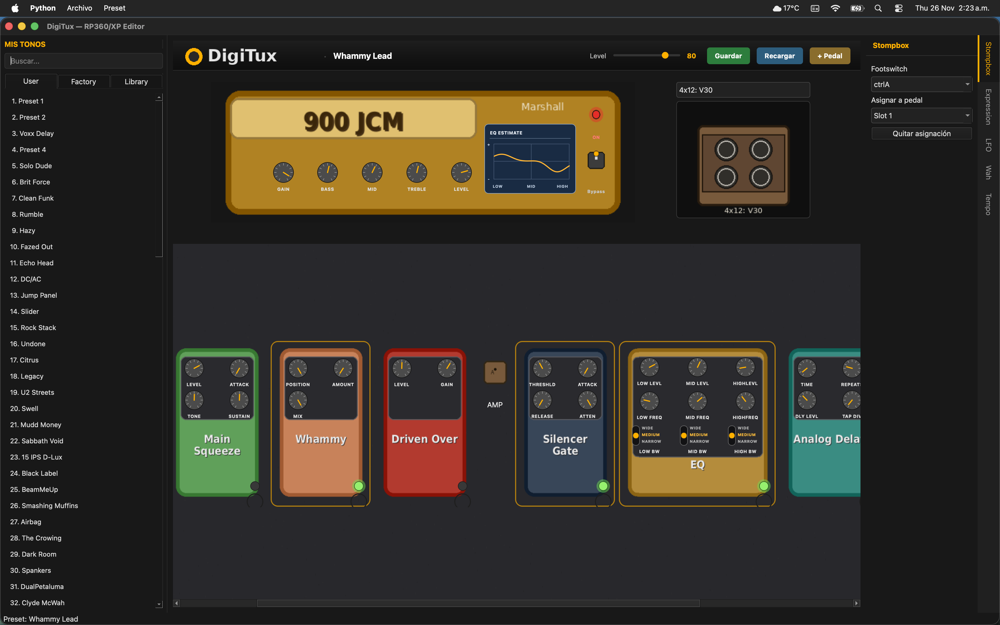

# DigiTux: a personal fork

[Español](README.md) | English


This is my fork of **DigiTux**, a free editor for the **DigiTech RP360 and
RP360XP**. My goal is to reach feature parity with DigiTech Nexus, bring back
some of the librarian workflows from X-Edit, and add features I wish Nexus and
DigiTux had.

I don't intend to compete with the original DigiTux. I started this fork as a
personal way to add the features I wanted to see, and I'll be happy to propose
these changes to the original project.

**Credit and thanks to [IlicaJ](https://github.com/IlicaJ)**, the creator of
the original [DigiTux](https://github.com/IlicaJ/digitux), for building the
project and making this fork possible.



## What works today

- Edit effect parameters, select models and cabinets, toggle effects, and
  reorder the pedalboard.
- Edit all three EQ bands on a wider pedal, with Wide/Medium/Narrow bandwidth
  switches.
- Browse User, Factory, and bundled Library presets; import and export presets;
  and back up or restore user presets as JSON.
- Configure stomp, expression, and LFO assignments.
- See an illustrative three-band EQ curve in the right-hand EQ Pedal panel,
  with frequency markers and an automatically adjusted dB scale. Frequency
  mappings between checked pedal values and filter shapes are approximate,
  not a measured response; the display excludes the amp, cabinet and other
  effects. A bypassed or absent EQ is indicated instead of a curve.
- Use the Tempo tab to tap or enter a session BPM and optionally apply note
  subdivisions to delay time and an assigned LFO. Both targets default to Off;
  changing the tempo or a subdivision updates enabled targets in the current
  edit buffer. Store the preset to keep those parameter changes.
  The BPM and subdivision choices are not saved or read from the pedal.
  Delay models without a TIME parameter and values outside the model's range
  cannot be synchronized. LFO speed conversion is approximate. Encoded values
  matched the RP360XP's displayed speeds at 0.05, 0.79, 1.00, 1.10, 2.50,
  and 10.00 Hz; the actual modulation rate has not been measured. The pedal's
  own TAP DIV setting is unchanged.
- Copy a saved User preset to the internal clipboard. The paste action is not
  implemented yet.
- Reset a User slot after confirmation. This **overwrites** it with a named
  default preset containing an amplifier and cabinet; it does not leave an
  empty slot.
- Synchronize supported parameter and preset changes with the connected pedal.
  Notifications update the UI, while a five-second reconciliation read catches
  missed changes. Serial commands are serialized and newer parameter changes
  are preserved when a reconciliation read completes.
- The interface follows the system language automatically: Spanish, English,
  French, German, Italian, or Japanese. Other languages use the original UI text.

The application was originally developed for Linux. Hardware and audio
behavior can vary by system and device; real-time synchronization does not
guarantee the absence of audio dropouts or communication errors.

## Installation

From the repository, with Python 3.9 or newer:

```bash
pip install .
digitux
```

Alternatively, install `pyserial` and `PyQt5` and run from the repository root:

```bash
python3 -m nexus.ui.main
# or
./run.sh
```

Connect the RP360/RP360XP over USB. On Linux, serial access may require a udev
rule. The supplied rule in `packaging/99-rp360.rules` and the packaging
configuration provide non-root access; review the rule before installing it.

The repository includes scripts for Linux binary, AppImage, and `.deb` builds.
The [original project's releases](https://github.com/IlicaJ/digitux/releases)
are upstream releases and may not include the changes in this fork. Publishing
installers for this fork is part of the roadmap below.

## What's next

These are goals, not promises or a release schedule.

### Nexus parity and packaging

- Publish a Debian/Ubuntu `.deb` for this fork with udev configuration, and a
  self-contained macOS `.dmg` for Apple Silicon and Intel.
- Expose global settings and three-footswitch modes, output compensation
  (Amp/Mixer), and expression pedal calibration.
- Continue improving and validating bidirectional synchronization on hardware.

### Librarian workflows

- Add a full-bank archive backup and restore workflow with progress reporting
  (`.rp360bank` or `.zip`), beyond the current JSON backup.
- Provide a true offline/virtual pedal mode for creating and editing presets.
- Build a dual-pane organizer for local presets and hardware slots, including
  drag-and-drop, multi-select, and batch operations.
- Expand slot initialization with a clean, bypassed template; the current reset
  action uses the default amp-and-cab preset described above.
- Save and reuse partial tone and effects chains without replacing a whole
  preset.
- Add A/B comparison between an edited preset and its original snapshot.

### Beyond Nexus and X-Edit

- Package standalone builds for Windows.
- Show human-readable preset differences and support version history.
- Add community-oriented preset tagging and search by metadata such as genre,
  artist, guitar type, and tags.

## Project layout

- `nexus/`: serial transport, protocol, device API, preset models, and effect
  database.
- `nexus/ui/`: the PyQt editor.
- `nexus/data/` and `nexus/assets/`: bundled presets and generated artwork.
- `packaging/`: Linux packaging and udev configuration.
- `docs/DESARROLLO.md`: development notes.

## Support the original project

If you appreciate the work that made this fork possible, consider supporting
IlicaJ:

[](https://www.buymeacoffee.com/lica)

## License and trademarks

DigiTux is free software under the [GPL-3.0 license](LICENSE). The application
uses generated artwork rather than the original product photographs.

DigiTech, Nexus, and RP360 are used for identification and interoperability.
This project is not affiliated with or endorsed by DigiTech or Harman.
