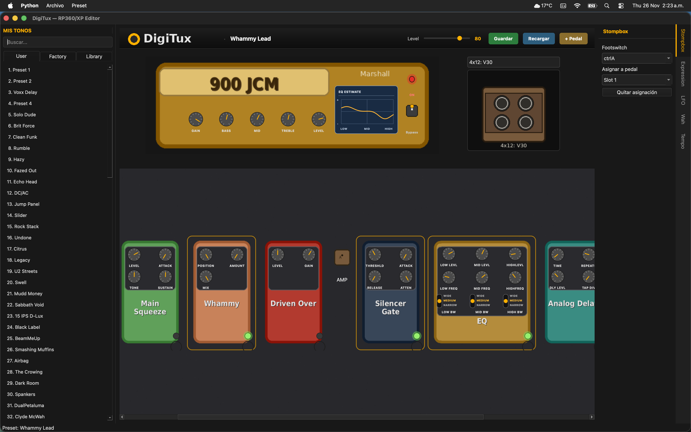

# DigiTux: un fork personal

Español | [English](README.en.md)


Este es mi fork de **DigiTux**, un editor libre para **DigiTech RP360 y
RP360XP**. Mi objetivo es alcanzar la paridad de funciones con DigiTech Nexus,
recuperar algunos flujos de gestión de presets de X-Edit y añadir funciones
que me hubiera gustado encontrar en Nexus y DigiTux.

No pretendo competir con el DigiTux original. Empecé este fork como una forma
personal de añadir las funciones que quería ver y estaré encantado de proponer
estos cambios al proyecto original.

**Créditos y agradecimientos a [IlicaJ](https://github.com/IlicaJ)**, creador
del [DigiTux original](https://github.com/IlicaJ/digitux), por desarrollar el
proyecto y hacer posible este fork.



## Funciones actuales

- Editar parámetros, seleccionar modelos y gabinetes, activar o desactivar
  efectos y reordenar la cadena.
- Editar las tres bandas del EQ en un pedal más ancho, con selectores de ancho
  de banda Wide/Medium/Narrow.
- Explorar los presets User, Factory y Library incluidos; importar y exportar
  presets; y respaldar o restaurar presets de usuario en JSON.
- Configurar asignaciones de stomp, expresión y LFO.
- Ver una curva ilustrativa del ecualizador de tres bandas en el amplificador.
  Las frecuencias entre los valores comprobados y las formas de los filtros son
  aproximadas, no una medición; la gráfica no incluye el amplificador, gabinete
  ni otros efectos. La escala vertical se ajusta a la curva. Se indica si el EQ
  está en bypass o ausente.
- En la pestaña Tempo se puede marcar o introducir un BPM de sesión y aplicar
  subdivisiones al tiempo del delay y al LFO asignado. Ambos destinos comienzan
  en Off; cambiar el tempo o una subdivisión actualiza los destinos activos en
  el preset de edición. Guarda el preset para conservar esos parámetros.
  El BPM y las subdivisiones no se guardan ni se leen del pedal. Los modelos de
  delay sin parámetro TIME y los valores fuera de rango no se sincronizan. La
  conversión de velocidad LFO es aproximada y no se ha verificado en hardware;
  el ajuste TAP DIV del pedal no se modifica.
- Copiar un preset User guardado al portapapeles interno. La acción de pegar
  aún no está implementada.
- Restablecer un preset de usuario con confirmación previa. Esto la **sobrescribe**
  con un preset predeterminado con nombre, amplificador y gabinete; la
  posición no queda vacía. Úsalo para borrar un preset de usuario y comenzar desde cero.
- Sincronizar los cambios compatibles de parámetros y presets con el pedal
  conectado. Las notificaciones actualizan la interfaz y una lectura de
  reconciliación cada cinco segundos recupera cambios no recibidos. Los
  comandos serie se serializan y los cambios de parámetros más recientes se
  conservan al completar una lectura.
- La interfaz cambia automáticamente según el idioma del sistema: español,
  inglés, francés, alemán, italiano o japonés. Los demás idiomas usan el texto
  original de la interfaz.

La aplicación se desarrolló originalmente para Linux. El comportamiento del
hardware y del audio puede variar según el sistema y el dispositivo; la
sincronización en tiempo real no garantiza la ausencia de interrupciones de
audio ni de errores de comunicación.

## Instalación

Desde el repositorio, con Python 3.9 o posterior:

```bash
pip install .
digitux
```

También puedes instalar `pyserial` y `PyQt5` y ejecutar desde la raíz del
repositorio:

```bash
python3 -m nexus.ui.main
# o
./run.sh
```

Conecta el RP360/RP360XP mediante USB. En Linux, el acceso al puerto serie
puede requerir una regla udev. La regla incluida en `packaging/99-rp360.rules`
y la configuración de empaquetado permiten el acceso sin root; revisa la regla
antes de instalarla.

El repositorio incluye scripts para generar binarios Linux, AppImage y `.deb`.
Las [versiones publicadas del proyecto original](https://github.com/IlicaJ/digitux/releases)
son versiones del proyecto original y pueden no incluir los cambios de este
fork. Publicar instaladores para este fork forma parte de los planes siguientes.

## Próximos pasos

Estos son objetivos, no promesas ni un calendario de lanzamientos.

### Paridad con Nexus y empaquetado

- Publicar un `.deb` para Debian/Ubuntu de este fork con configuración udev y
  un `.dmg` autónomo para macOS en Apple Silicon e Intel.
- Exponer los ajustes globales y los modos de tres footswitches, la compensación
  de salida (Amp/Mixer) y la calibración del pedal de expresión.
- Seguir mejorando y validando la sincronización bidireccional con el hardware.

### Gestión de presets

- Añadir respaldo y restauración del banco completo en un archivo con indicador
  de progreso (`.rp360bank` o `.zip`), además del respaldo JSON actual.
- Ofrecer un modo offline o pedal virtual para crear y editar presets.
- Crear un organizador de dos paneles para presets locales y posiciones del
  dispositivo, con arrastrar y soltar, selección múltiple y operaciones en lote.
- Ampliar la inicialización de posiciones con una plantilla limpia y en
  bypass; la acción actual utiliza el preset de amplificador y gabinete
  descrito anteriormente.
- Guardar y reutilizar partes de tonos y cadenas de efectos sin reemplazar un
  preset completo.
- Añadir comparación A/B entre un preset editado y su estado original.

### Más allá de Nexus y X-Edit

- Empaquetar versiones autónomas para Windows.
- Mostrar diferencias legibles entre presets y ofrecer historial de versiones.
- Añadir etiquetas y búsqueda de presets orientadas a la comunidad mediante
  metadatos como género, artista, tipo de guitarra y etiquetas.

## Estructura del proyecto

- `nexus/`: transporte serie, protocolo, API del dispositivo, modelos de preset
  y base de datos de efectos.
- `nexus/ui/`: el editor PyQt.
- `nexus/data/` y `nexus/assets/`: presets incluidos y gráficos generados.
- `packaging/`: empaquetado para Linux y configuración udev.
- `docs/DESARROLLO.md`: notas de desarrollo.

## Apoya el proyecto original

Si aprecias el trabajo que hizo posible este fork, considera apoyar a IlicaJ:

[](https://www.buymeacoffee.com/lica)

## Licencia y marcas

DigiTux es software libre bajo la [licencia GPL-3.0](LICENSE). La aplicación
utiliza gráficos generados en lugar de las fotografías originales del producto.

DigiTech, Nexus y RP360 se usan para identificación e interoperabilidad. Este
proyecto no está afiliado ni respaldado por DigiTech o Harman.
